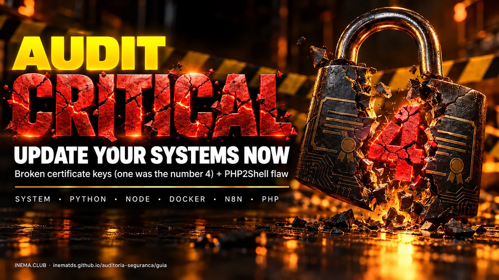

# 🛡️ auditoria-seguranca

[](https://inematds.github.io/auditoria-seguranca/guia/en/)

**🇧🇷 [Português](README.md) · 🇺🇸 [English](README.en.md) · 🇪🇸 [Español](README.es.md)**

**Guide v1.1.2 · updated on 10/23/2026** <!-- versao: ferramentas/versao.py -->

## What it is

This is a security guide for anyone running a server, website, automation, or AI agent. In October 2026, two serious pieces of news arrived together: the secret keys of 8 certificates from the eMudhra certificate authority leaked (one of them was literally number 4), and a flaw in PHP, called PHP2Shell, allows sites to be broken into without a password. The guide shows how to test whether each tool is still exposed, using a script that doesn't install or change anything (it only runs the tests), and how to update each layer. All you need is a terminal on the machine you want to check.

## 📖 User guide

Full guide (what happened, how to audit, how to update, real case, PHP2Shell, routine): **https://inematds.github.io/auditoria-seguranca/guia/en/**

## 10-second test

```bash
curl https://dv-g3b-emudhra.we-have-a-problem.com/
curl https://dv-g3b-aaa-emudhra.we-have-a-problem.com/
# "SSL certificate problem" = protegido (protected) · showed the page = EXPOSTO (EXPOSED)
```

The browser is already protected. Old curl, Python (certifi), Node, Deno, Bun, Java, Go, Docker, n8n, and AI agents have their own certificate list (or follow the system's/container's) and need their own fix.

## ⚠ Before and after updating

> **Before updating anything:** make a backup (database, volumes, old image with a fallback tag, configuration) and confirm the system is healthy **before**.
>
> ```bash
> docker exec meu-postgres pg_dumpall -U postgres > backup-$(date +%F).sql   # database
> docker tag meuapp:latest meuapp:pre-update                              # old image as a fallback
> docker inspect meuapp > meuapp.inspect.json                             # ports, env, volumes
> curl -fsS https://meusite/health && echo OK                             # health before
> docker exec meu-postgres psql -U postgres -d app -c "select count(*) from clientes"   # note the numbers
> ```
>
> **After updating:** a lot of what was running can become incompatible with the new version (we've seen an unpinned dependency break an app, a venv resync and undo the fix, a proxy with an old address returning 502). Test and validate: the service came up, responds, does what it used to do, and the data is there (same counts). Only call it done when it's ok **and live**.

## The `audita.sh` script (changes nothing)

It tests the **real connection** (not just a certificate list) with curl, wget, every Node, Deno, and Bun on disk (including embedded ones), the system Python, every venv and conda environment with its own certifi, and every running Docker container. It also checks the Java list (`cacerts`, via `keytool`), the PHP version on the server and in containers (PHP2Shell), and the processes that need to be restarted. At the end, it groups what it found by type with the suggested fix.

States: `EXPOSTO` (EXPOSED — connected), `protegido` (protected — the certificate was refused, with a verification code or message), `SEM TESTE` (NO TEST — the test didn't finish or proves nothing: network, DNS, timeout, container without a shell or without the tool, truncated output, an SSH that failed, an interrupted disk search, a program that isn't safe to run — never counts as protected), `VERIFIQUE` (CHECK — PHP in a test version, or distribution PHP below the fixed version: check the backport) and `REINICIE` (RESTART — process running with the old program or list).

```bash
curl -fsSLO https://raw.githubusercontent.com/inematds/auditoria-seguranca/main/audita.sh
less audita.sh                              # read it before running
chmod +x audita.sh
./audita.sh                                 # this machine (up to 3 min)
./audita.sh --rapido                        # no disk search
./audita.sh --comandos                      # lists the fix commands (does not run them)
./audita.sh --go                            # real Go test (compiles in a temp folder, ~100 MB, deleted at the end)
./audita.sh --ssh root@servidor1 --ssh deploy@servidor2
./audita.sh --chave ~/.ssh/minha_chave --ssh root@servidor1
./audita.sh --hosts servidores.txt          # one SSH target per line
./audita.sh --raiz /opt --raiz /srv         # searches the disk only in these folders
```

Exit code: `0` the checks that were done passed, **within the scope printed at the end** (`--rapido`, `--sem-docker`, `--raiz`, `--php-ok`, and the user appear there) · `1` there is an EXPOSTO · `2` there is a SEM TESTE · `3` processes need restarting or PHP needs checking.

> **The script points out problems; it is not a "everything protected" certificate.** Exit `0` doesn't mean the whole machine is safe, and it shouldn't release a deploy by itself. It doesn't install, change, or fix anything, but it runs the tools it tests. With `sudo`, a program found on disk only runs if the file, every link, and every folder on the path belong to root or to the owner and nobody else can write to them; a user's program runs as that user (`runuser`), never as root. Anything that doesn't pass becomes `SEM TESTE`.

The script's own tests (no network, no real containers): `bash testes/roda.sh`.

## Fixed versions (eMudhra)

| Layer | Version |
|---|---|
| Ubuntu | `20260816ubuntu0.<Ubuntu version>` (e.g., `20260816ubuntu0.24.04.1`) |
| Debian | `20250419~deb12u2` (12) · `20250419+deb13u1` (13) |
| Alpine | `20261020-r0` |
| Python | `certifi 2026.10.19` · `pip 26.2.2` · `uv 0.13.5` · Python itself `3.15.1` · `3.14.9` · `3.13.17` |
| Node | `22.23.4` · `24.22.1` · `26.12.1` (Node 20 has no fix) |
| Go | `1.27.3` · `1.26.10` + recompile (on Linux it follows the system list) |
| Java | remove the two roots from `cacerts` with `keytool -delete` (`update-ca-certificates -f` alone does not remove them) or a new JDK |
| Deno · Bun | rejected in our test: `2.9.8` · `1.4.4` |
| Firefox / NSS | `158.0.1` · `3.131.1` |
| Electron | `44.9.1` · `43.8.1` · `42.11.16` |
| Rust | `rustls-webpki 0.103.16` · `webpki-roots 1.0.10` |
| FreeBSD | `ca_root_nss 1.131.1` (ports) · base `15.1-RELEASE-p6` · `14.5-RELEASE-p3` · `14.4-RELEASE-p12` (FreeBSD-SA-26:73) |

## PHP2Shell

`CVE-2026-109618` and `CVE-2026-109619`, remote execution without login. Fixed in **PHP 8.5.12 · 8.4.27 · 8.3.36 · 8.2.35**. Checker: [openai/php2shell-checker](https://github.com/openai/php2shell-checker). Details, temporary mitigations, and signs of intrusion in the guide.

**New PHP notice (10/23/2026, `CVE-2026-115560`):** keep `session.upload_progress.enabled = 0` even after updating, until the next regular release. It only affects apps that switch `session.serialize_handler` to `php` at runtime (with `ini_set()` before `session_start()`); those that never switch can leave the feature on.

## The process, from start to finish

| # | Step | Command | Who |
|---|---|---|---|
| 1 | Quick curl test on both chains | `curl https://dv-g3b-emudhra.we-have-a-problem.com/` | 🧠 you |
| 2 | Full audit of the machine, with the list of fixes | `./audita.sh --comandos` | ⚙️ script |
| 3 | Audit of the servers | `./audita.sh --hosts servidores.txt` | ⚙️ script |
| 4 | Backup (database, volumes, old image with a fallback tag, configuration) and health BEFORE | `pg_dumpall` · `docker tag  :pre-update` · `docker inspect > x.json` · `curl -fsS …/health` | 🧠 you |
| 5 | PHP2Shell first (attacks in progress): test, update, restart workers (server and containers) | `node phpcheck.js https://seusite` · `sudo apt install --only-upgrade $(dpkg -l 'php*' \| awk '/^ii/{print $2}')` | 🧠 you |
| 6 | Update the system (and Java's `cacerts`) | `sudo apt install --only-upgrade ca-certificates` · `sudo keytool -delete -alias … -keystore /etc/ssl/certs/java/cacerts` | 🧠 you |
| 7 | Update certifi in each venv / conda | `<venv>/bin/python -m pip install -U certifi` · `uv pip install --python <venv>/bin/python -U certifi` | 🧠 you |
| 8 | Switch Node (20 → 22/24), update Deno and Bun | `nvm install 22` · `sudo apt install --only-upgrade nodejs` · `deno upgrade` · `bun upgrade` | 🧠 you |
| 9 | Containers by group: A pull and recreate · B layer on top · C bump the version / Supabase | `docker compose up -d --pull always <svc>` · `FROM :pre-emudhra` · `pg_dumpall` + `npx -y supabase@latest stop && npx -y supabase@latest start` | 🧠 you |
| 10 | Find and restart services (outside of jobs/uploads/live streams) | `processos a reiniciar` section of the script · `systemctl restart …` · `pm2 restart all` | 🧠 you |
| 11 | Test and validate: it came up, responds, does what it used to, same data (counts); only done when ok and live | `docker compose ps` · `curl -fsS …/health` · `select count(*)` | 🧠 you |
| 12 | Audit again until clean (full pass, scope with nothing important left out) | `./audita.sh` → `0 EXPOSTO · 0 SEM TESTE · 0 VERIFIQUE · 0 REINICIE` (exit 0; distribution PHP checked: `--php-ok`) | ⚙️ script |
| 13 | Monthly routine | checklist in the guide's Routine section | 🧠 you |

The version history is in [CHANGELOG.md](CHANGELOG.md).

## Sources

- https://emudhra.we-have-a-problem.com/
- https://bugzilla.mozilla.org/show_bug.cgi?id=2083449
- https://blog.google/security/protecting-chrome-and-android-users-from-compromised-emudhra-intermediate-ca-certificates/
- https://socradar.io/blog/emudhra-ca-key-compromise-weak-keys-risks-and-fixes/
- https://www.php.net/archive/2026.php#2026-10-21-5
- https://www.php.net/archive/2026.php (notice of 10/23/2026, CVE-2026-115560)
- https://github.com/openai/php2shell-checker

## License

MIT. Open and free — [INEMA.CLUB](https://inema.club).
