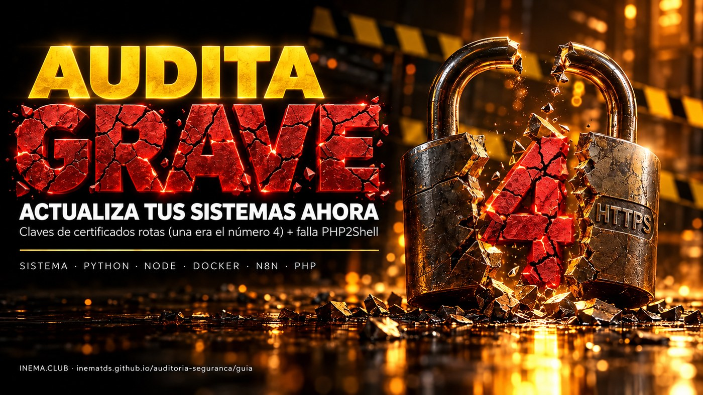

# 🛡️ auditoria-seguranca

[](https://inematds.github.io/auditoria-seguranca/guia/es/)

**🇧🇷 [Português](README.md) · 🇺🇸 [English](README.en.md) · 🇪🇸 [Español](README.es.md)**

## Qué es

Esta es una guía de seguridad para quien tiene un servidor, un sitio, una automatización o un agente de IA en funcionamiento. En octubre de 2026 llegaron juntas dos noticias graves: se filtraron las claves secretas de 8 certificados de la certificadora eMudhra (una de ellas era literalmente la número 4), y una falla en PHP, llamada PHP2Shell, permite invadir sitios sin contraseña. La guía muestra cómo probar si cada herramienta sigue expuesta, con un script que solo lee y no cambia nada, y cómo actualizar cada capa. Solo necesitas una terminal en la máquina que quieres revisar.

## 📖 Guía de uso

Guía completa (qué pasó, cómo auditar, cómo actualizar, caso real, PHP2Shell, rutina): **https://inematds.github.io/auditoria-seguranca/guia/es/**

## Prueba en 10 segundos

```bash
curl https://dv-g3b-emudhra.we-have-a-problem.com/
curl https://dv-g3b-aaa-emudhra.we-have-a-problem.com/
# "SSL certificate problem" = protegido · mostró la página = EXPOSTO (expuesto)
```

El navegador ya está protegido. curl antiguo, Python (certifi), Node, Deno, Bun, Java, Go, Docker, n8n y agentes de IA tienen su propia lista de certificados (o siguen la del sistema/contenedor) y necesitan una corrección propia.

## El script `audita.sh` (solo lectura) — versión 1.1.0

Prueba la **conexión real** (no solo la lista de certificados) con curl, wget, cada Node, Deno y Bun del disco (incluidos los embebidos), el Python del sistema, cada venv y entorno conda con su certifi y cada contenedor Docker en ejecución. También revisa la lista de Java (`cacerts`, mediante `keytool`), la versión de PHP en el servidor y en los contenedores (PHP2Shell) y los procesos que necesitan reiniciarse. Al final, agrupa lo que encontró por tipo con la corrección sugerida.

Estados: `EXPOSTO` (expuesto; conectó), `protegido` (error de certificado), `SEM TESTE` (sin prueba; red/DNS/timeout — no cuenta como protegido), `VERIFIQUE` (verifica; PHP de distribución por debajo de la versión corregida: revisa el backport) y `REINICIE` (reinicia; proceso ejecutándose con el programa o la lista antigua).

```bash
curl -fsSLO https://raw.githubusercontent.com/inematds/auditoria-seguranca/main/audita.sh
less audita.sh                              # lee antes de ejecutar
chmod +x audita.sh
./audita.sh                                 # esta máquina (hasta 3 min)
./audita.sh --rapido                        # sin búsqueda en el disco
./audita.sh --comandos                      # lista los comandos de corrección (no ejecuta)
./audita.sh --go                            # prueba real de Go (compila en carpeta temporal, ~100 MB, borrada al final)
./audita.sh --ssh root@servidor1 --ssh deploy@servidor2
./audita.sh --chave ~/.ssh/minha_chave --ssh root@servidor1
./audita.sh --hosts servidores.txt          # un destino SSH por línea
```

Salida: `0` nada expuesto · `1` hay EXPOSTO · `2` hay una prueba que no se ejecutó. El script nunca instala, modifica ni corrige nada; solo escribe en una carpeta temporal que se borra al final.

## Versiones corregidas (eMudhra)

| Capa | Versión |
|---|---|
| Ubuntu | `20260816ubuntu0.<versión de Ubuntu>` (ej.: `20260816ubuntu0.24.04.1`) |
| Debian | `20250419~deb12u2` (12) · `20250419+deb13u1` (13) |
| Alpine | `20261020-r0` |
| Python | `certifi 2026.10.19` · `pip 26.2.2` · `uv 0.13.4` |
| Node | `22.23.4` · `24.22.1` · `26.12.1` (Node 20 sin corrección) |
| Go | `1.27.3` · `1.26.10` + recompilar (en Linux sigue la lista del sistema) |
| Java | `sudo update-ca-certificates -f` (rehace el `cacerts`) o JDK nuevo |
| Deno · Bun | rechazaron en nuestra prueba: `2.9.8` · `1.4.4` |
| Firefox / NSS | `158.0.1` · `3.131.1` |
| Electron | `44.9.1` · `43.8.1` · `42.11.16` |
| Rust | `rustls-webpki 0.103.16` · `webpki-roots 1.0.10` |

## PHP2Shell

`CVE-2026-109618` y `CVE-2026-109619`, ejecución remota sin inicio de sesión. Corregido en **PHP 8.5.12 · 8.4.27 · 8.3.36 · 8.2.35**. Verificador: [openai/php2shell-checker](https://github.com/openai/php2shell-checker). Detalles, mitigaciones temporales y señales de intrusión en la guía.

## El proceso, de principio a fin

| # | Paso | Comando | Quién |
|---|---|---|---|
| 1 | Prueba rápida con curl en las dos cadenas | `curl https://dv-g3b-emudhra.we-have-a-problem.com/` | 🧠 tú |
| 2 | Auditoría completa de la máquina, con la lista de correcciones | `./audita.sh --comandos` | ⚙️ script |
| 3 | Auditoría de los servidores | `./audita.sh --hosts servidores.txt` | ⚙️ script |
| 4 | Actualizar el sistema (y el `cacerts` de Java) | `sudo apt install --only-upgrade ca-certificates` · `sudo update-ca-certificates -f` | 🧠 tú |
| 5 | Actualizar el certifi de cada venv / conda | `<venv>/bin/python -m pip install -U certifi` · `uv pip install --python <venv>/bin/python -U certifi` | 🧠 tú |
| 6 | Cambiar Node (20 → 22/24), actualizar Deno y Bun | `nvm install 22` · `sudo apt install --only-upgrade nodejs` · `deno upgrade` · `bun upgrade` | 🧠 tú |
| 7 | Contenedores por grupo: A descargar y recrear · B capa por encima · C subir la versión / Supabase | `docker compose up -d --pull always <svc>` · `FROM :pre-emudhra` · `supabase stop && supabase start` | 🧠 tú |
| 8 | Encontrar y reiniciar servicios (fuera de job/upload/live) | sección `processos a reiniciar` del script · `systemctl restart …` · `pm2 restart all` | 🧠 tú |
| 9 | Auditar de nuevo hasta dejar en cero | `./audita.sh` → `0 EXPOSTO · 0 SEM TESTE` | ⚙️ script |
| 10 | PHP: probar, actualizar, reiniciar workers (servidor y contenedores) | `node phpcheck.js https://tusitio` · `apt install --only-upgrade 'php*'` | 🧠 tú |
| 11 | Rutina mensual | checklist de la sección Rutina de la guía | 🧠 tú |

El historial de versiones está en el [CHANGELOG.md](CHANGELOG.md).

## Fuentes

- https://emudhra.we-have-a-problem.com/
- https://bugzilla.mozilla.org/show_bug.cgi?id=2083449
- https://blog.google/security/protecting-chrome-and-android-users-from-compromised-emudhra-intermediate-ca-certificates/
- https://socradar.io/blog/emudhra-ca-key-compromise-weak-keys-risks-and-fixes/
- https://www.php.net/archive/2026.php#2026-10-21-5
- https://github.com/openai/php2shell-checker

## Licencia

MIT. Abierto y gratuito — [INEMA.CLUB](https://inema.club).
