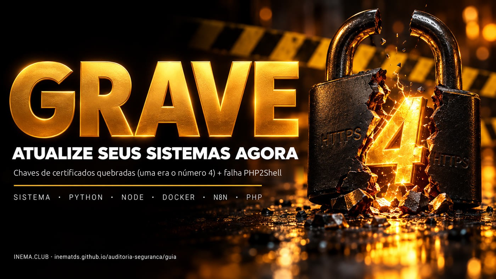

# 🛡️ auditoria-seguranca

[](https://inematds.github.io/auditoria-seguranca/guia/)

**🇧🇷 [Português](README.md) · 🇺🇸 [English](README.en.md) · 🇪🇸 [Español](README.es.md)**

## O que é

Este é um guia de segurança para quem tem servidor, site, automação ou agente de IA rodando. Em outubro de 2026 vieram duas notícias graves juntas: vazaram as chaves secretas de 8 certificados da certificadora eMudhra (uma delas era literalmente o número 4), e uma falha no PHP, chamada PHP2Shell, deixa invadir sites sem senha. O guia mostra como testar se cada ferramenta ainda está exposta, com um script que só lê e não muda nada, e como atualizar cada camada. Precisa só de um terminal na máquina que você quer conferir.

## 📖 Guia de uso

Guia completo (o que houve, como auditar, como atualizar, caso real, PHP2Shell, rotina): **https://inematds.github.io/auditoria-seguranca/guia/**

## Teste em 10 segundos

```bash
curl https://dv-g3b-emudhra.we-have-a-problem.com/
curl https://dv-g3b-aaa-emudhra.we-have-a-problem.com/
# "SSL certificate problem" = protegido · mostrou a página = EXPOSTO
```

O navegador já está protegido. curl antigo, Python (certifi), Node, Go, Docker, n8n e agentes de IA têm lista própria de certificados e precisam de correção própria.

## O script `audita.sh` (só leitura)

Testa a **conexão real** (não só lista certificados) com curl, wget, cada Node do disco (inclusive Node embutido), o Python do sistema, cada venv com o certifi dele e cada container Docker em execução. Três estados: `EXPOSTO` (conectou), `protegido` (erro de certificado) e `SEM TESTE` (rede/DNS/timeout — não conta como protegido).

```bash
curl -fsSLO https://raw.githubusercontent.com/inematds/auditoria-seguranca/main/audita.sh
less audita.sh                              # leia antes de rodar
chmod +x audita.sh
./audita.sh                                 # esta máquina (até 3 min)
./audita.sh --rapido                        # sem busca no disco
./audita.sh --ssh root@servidor1 --ssh deploy@servidor2
./audita.sh --hosts servidores.txt          # um destino SSH por linha
```

Saída: `0` nada exposto · `1` há EXPOSTO · `2` há teste que não rodou.

## Versões corrigidas (eMudhra)

| Camada | Versão |
|---|---|
| Ubuntu | `ca-certificates 20260816ubuntu0.<versão>` |
| Debian | `20250419~deb12u2` · `+deb13u1` |
| Alpine | `20261020-r0` |
| Python | `certifi 2026.10.19` · `pip 26.2.2` · `uv 0.13.4` |
| Node | `22.23.4` · `24.22.1` · `26.12.1` (Node 20 sem correção) |
| Go | `1.27.3` · `1.26.10` + recompilar |
| Firefox / NSS | `158.0.1` · `3.131.1` |
| Electron | `44.9.1` · `43.8.1` · `42.11.16` |
| Rust | `rustls-webpki 0.103.16` · `webpki-roots 1.0.10` |

## PHP2Shell

`CVE-2026-109618` e `CVE-2026-109619`, execução remota sem login. Corrigido em **PHP 8.5.12 · 8.4.27 · 8.3.36 · 8.2.35**. Verificador: [openai/php2shell-checker](https://github.com/openai/php2shell-checker). Detalhes, mitigações temporárias e sinais de invasão no guia.

## O processo, do início ao fim

| # | Passo | Comando | Quem |
|---|---|---|---|
| 1 | Teste rápido com curl nas duas cadeias | `curl https://dv-g3b-emudhra.we-have-a-problem.com/` | 🧠 você |
| 2 | Auditoria completa da máquina | `./audita.sh` | ⚙️ script |
| 3 | Auditoria dos servidores | `./audita.sh --hosts servidores.txt` | ⚙️ script |
| 4 | Atualizar o sistema | `sudo apt install --only-upgrade ca-certificates` | 🧠 você |
| 5 | Atualizar o certifi de cada venv | `<venv>/bin/python -m pip install -U certifi pip` | 🧠 você |
| 6 | Trocar o Node (20 → 22/24) | `nvm install 22` ou repositório NodeSource `setup_22.x` | 🧠 você |
| 7 | Reconstruir containers / atualizar n8n (com backup) | `docker compose build --pull` / `docker compose pull` | 🧠 você |
| 8 | Reiniciar serviços | `systemctl restart …` · `pm2 restart all` · `docker compose up -d` | 🧠 você |
| 9 | Auditar de novo até zerar | `./audita.sh` → `0 EXPOSTO · 0 SEM TESTE` | ⚙️ script |
| 10 | PHP: testar, atualizar, reiniciar workers | `node phpcheck.js https://seusite` · `apt install --only-upgrade 'php*'` | 🧠 você |
| 11 | Rotina mensal | checklist da seção Rotina do guia | 🧠 você |

## Fontes

- https://emudhra.we-have-a-problem.com/
- https://bugzilla.mozilla.org/show_bug.cgi?id=2083449
- https://blog.google/security/protecting-chrome-and-android-users-from-compromised-emudhra-intermediate-ca-certificates/
- https://socradar.io/blog/emudhra-ca-key-compromise-weak-keys-risks-and-fixes/
- https://www.php.net/archive/2026.php#2026-10-21-5
- https://github.com/openai/php2shell-checker

## Licença

MIT. Aberto e gratuito — [INEMA.CLUB](https://inema.club).
